<div align="center">

# 🧠 reAgent

**A minimal, hackable AI agent built on the ReAct reasoning loop.**

[](https://python.org)
[](LICENSE)
[](https://arxiv.org/abs/2210.03629)
[](https://openrouter.ai)
[](https://platform.openai.com/docs)
[](https://github.com/astral-sh/uv)

<br>

A clean implementation of [ReAct (Reasoning + Acting)](https://arxiv.org/abs/2210.03629) with Plan-and-Execute capabilities. No bloated frameworks — just a transparent loop you can read, modify, and learn from in an afternoon.

<br>



<br>

</div>


## Quick start

### 1. Set up environment variables

Create `deploy/.env`:

```env
LLM_API_KEY=your-provider-key
LLM_BASE_URL=https://api.deepseek.com
LLM_MODEL=deepseek-chat
LLM_TIMEOUT_SECONDS=120
```

`LLM_API_KEY` is already provider-neutral. To switch to another OpenAI-compatible model, change `LLM_BASE_URL` and `LLM_MODEL`; no code edit is required. Set `LLM_ENV_FILE` when the credentials live elsewhere. Existing `OPENROUTER_API_KEY` installations remain supported.

### 2. Install dependencies

```bash
pip install uv   # if you don't have uv yet
uv sync
```

### 3. Run the agent

```bash
uv run react-agent ./your-project-directory
```

The agent will start an interactive session, reasoning about your files and executing tool calls inside the directory you point it to.


## How ReAct works

**ReAct** ([Yao et al., 2022](https://arxiv.org/abs/2210.03629)) interleaves *reasoning* and *acting* in a single loop so the model can observe real-world feedback before deciding its next step.

| Step | What happens |
|---|---|
| **Thought** | The LLM reasons about the current state and decides what to do next. |
| **Action** | A tool call is dispatched — read a file, write code, run a shell command. |
| **Observation** | The tool's output is fed back into the conversation as new context. |
| **Final answer** | When no more tools are needed, the agent returns its conclusion. |

The loop continues until the model produces a `<final_answer>` tag or an error halts execution.


## Architecture

```
env   = Environment()
tools = Tools(env)
prompt = "Goals, constraints, and how to act"

while True:
    action = llm.run(prompt + env.state)
    env.state = tools.run(action)
```

The `ReActAgent` class handles four things and nothing else:

1. **Rendering** the system prompt (injecting available tools, OS info, and file listings).
2. **Orchestrating** the message history sent to the LLM.
3. **Parsing** structured `<thought>`, `<action>`, and `<final_answer>` tags from model output.
4. **Dispatching** tool calls and feeding observations back into the loop.


## Built-in tools

| Tool | Description |
|---|---|
| `read_file(path)` | Read a text file from disk. |
| `write_to_file(path, content)` | Write text content to a file. |
| `run_terminal_command(cmd)` | Execute a shell command and return output. |

Terminal commands require explicit user confirmation before execution — all other tools run automatically. Extend the agent by adding entries to `get_default_tools()` in `tools.py`.


## Parser design

The parser uses a **finite-state machine** to split LLM output into function name + arguments, handling:

- Quoted strings with escaped characters (`"hello \"world\""`)
- Nested parentheses (`(1, (2, 3))`)
- Mixed argument types (strings, ints, lists)

It only splits on commas that are *outside* any quoted string and at parenthesis depth zero — similar to a simplified pushdown automaton.

```
write_to_file("tests/index.html", "<html><body>Hello</body></html>")
         ↓ parse
func  = "write_to_file"
args  = ["tests/index.html", "<html><body>Hello</body></html>"]
```

### Design boundary

> The prompt is non-deterministic: where we can leverage the decision llm make but not always stable The code is determinsitic: stable


## Plan-and-Execute

Reference: [LangGraph — Plan-and-Execute](https://langchain-ai.github.io/langgraph/tutorials/plan-and-execute/plan-and-execute/)

Plan-and-Execute decomposes a high-level goal into a sequence of sub-tasks, then executes them one by one using the ReAct loop. This enables longer-horizon reasoning for complex tasks.


## Project structure

```
react_agent/
├── core/
│   ├── agent.py          # ReAct loop orchestration
│   ├── llm_client.py     # OpenAI-compatible LLM adapter
│   ├── parser.py         # FSM-based action parser
│   ├── policy.py         # Permission rules for sensitive tools
│   └── tools.py          # Tool definitions and registry
├── prompt_template.py    # System prompt template
└── global_utils.py       # OS detection, logging, API key loading
```


## Lessons learned

A few hard-won insights from building and debugging this agent:

- **Observation design matters.**
  - Observations come from the environment, never the model. 
  - Always return tool output, errors, and command results  the LLM can't know an action's real consequence on its own, only what it saw in training.

- **LLM output is messy.**
  - Models sometimes use `echo` for file writes, split strings across arguments, or forget to quote content. `_sanitize_action` catches and fixes these cases. 
  - Providers' `structured-output` modes avoid the problem entirely by constraining decoding to a grammar, guaranteeing valid format.

- **Tool permissions are essential.**
  - Letting an LLM run arbitrary shell commands unchecked is a recipe for disaster. `policy.py` gates dangerous operations behind explicit user approval. 
  - Ideally, commands run in a sandboxed shell (e.g. OpenShell) that can swap credentials and enforce policy checks.
